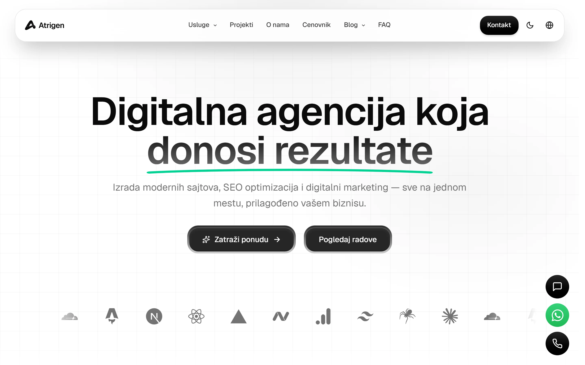
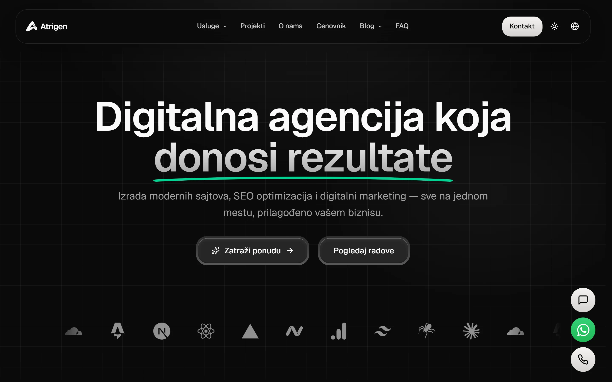
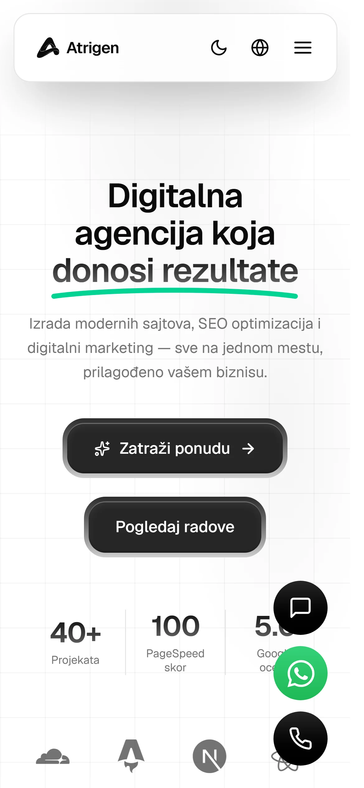
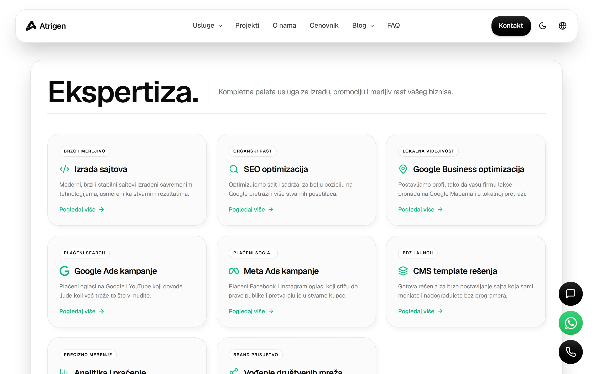
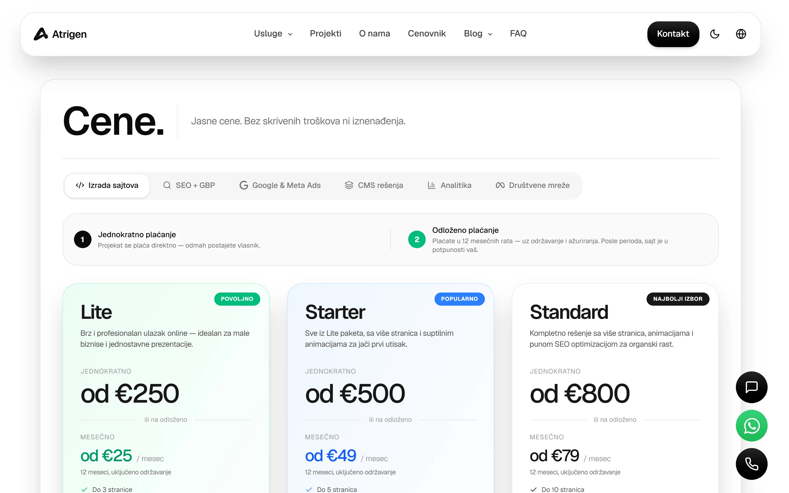
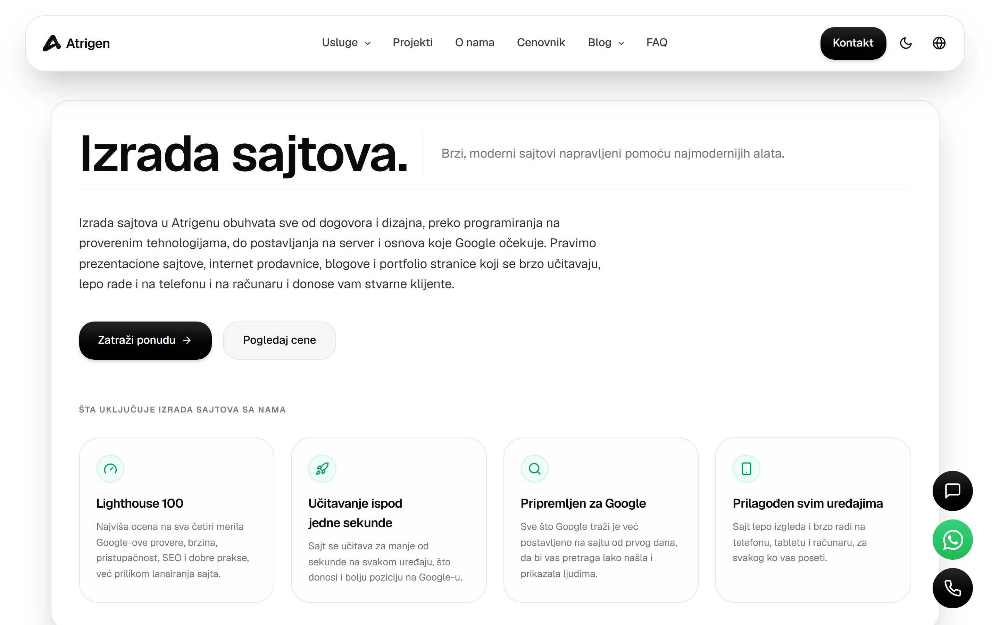

# Atrigen — Digitalna agencija

**Live:** [atrigen.rs](https://atrigen.rs) · **Preview:** [atrigen-preview.pages.dev](https://atrigen-preview.pages.dev)

Web sajt digitalne agencije Atrigen — izrada modernih sajtova, SEO optimizacija, Google i Meta Ads kampanje, CMS rešenja i digitalni marketing. Statički generisan, ekstremno brz, bilingual (SR/EN), sa AI chatbot-om koji odgovara na pitanja klijenata u realnom vremenu i preporučuje pakete iz cenovnika.



## Tech stack


## Šta uključuje

- **17 stranica** — Početna, Usluge listing + 8 service podstranica, Cenovnik, Kontakt, Česta pitanja, O nama, Projekti + 404
- **Bilingual** — pun SR + EN sadržaj sa lang switcher-om i scroll restore
- **AI chatbot** — embedded widget sa RAG-om iz cenovnika (Cloudflare Vectorize + bge-m3 embeddings + Google Gemini 2.5 Flash-Lite); 50 poruka po sesiji, mobile body lock, 3-layer defense (input filter → RAG quality gate → output filter), email transkript po završenoj sesiji
- **Light/dark theme** — sistem detekcija + manuelni toggle, no FOUC
- **Interaktivne demo sekcije** — svaka service stranica ima animiranu mockup sekciju (browser SERP climb za SEO, Google Ads sponsored climb, Instagram/Facebook feed scroll za Meta Ads, terminal → preview swap za izradu sajtova...)
- **SEO** — Schema.org Service per stranica, Open Graph, Twitter cards, sitemap, canonical URLs, FAQ JSON-LD
- **Performance** — Astro static, inline CSS, font preload, async script preconnect, mobile-first

## Stranice

| Ruta | Sadržaj |
|---|---|
| `/` | Početna sa interaktivnim cobe globe-om, FAQ, Reviews |
| `/usluge` | Listing svih 8 servisa |
| `/usluge/izrada-sajtova` | Web razvoj sa Lighthouse score demo |
| `/usluge/seo-optimizacija` | SEO sa Google search SERP climb animacijom |
| `/usluge/google-ads-kampanje` | Google Ads sa sponsored result climb-om |
| `/usluge/meta-ads-kampanje` | Meta Ads sa dual mockup (iPhone IG + MacBook FB) |
| `/usluge/google-business-optimizacija` | Lokalni SEO sa Google Maps demo |
| `/usluge/cms` | CMS template-i sa admin panel demo |
| `/usluge/analitika` | GA4 dashboard sa cursor click animacijom |
| `/usluge/drustvene-mreze` | Vođenje mreža sa FB/IG profil mockup |
| `/cenovnik` | Cene po kategorijama (web/seo/ads/cms/analytics/social) |
| `/kontakt` | Kontakt forma + kanal hub (AI, WhatsApp, telefon, email) |
| `/cesta-pitanja` | FAQ accordion |

## Screenshots

### Home (desktop)




### Home (mobile)



### Usluge listing



### Cenovnik



### Service podstranica (Izrada sajtova)



## Arhitektura

```
┌─────────────────────────────────────────────────────────┐
│                  Browser (atrigen.rs)                   │
│   ChatWidget.astro + chat-client.ts (state machine)     │
└─────────────────────────────────────────────────────────┘
                            │
                ┌───────────┴───────────┐
                │  Cloudflare Pages CDN │
                │  (Astro static + JS)  │
                └───────────┬───────────┘
                            │
            ┌───────────────┴───────────────┐
            │   Pages Functions (workers)   │
            │   /api/chat/start             │
            │   /api/chat/message           │
            │   /api/chat/end               │
            │   /api/chat/history           │
            └───┬─────┬─────┬─────┬─────────┘
                │     │     │     │
        ┌───────┘     │     │     └─────────┐
        ▼             ▼     ▼               ▼
   ┌────────┐    ┌──────┐  ┌──────────┐  ┌─────────┐
   │   D1   │    │  KV  │  │Vectorize │  │ Gemini  │
   │(SQLite)│    │(rate │  │(RAG kb,  │  │ 2.5     │
   │transk. │    │limit)│  │bge-m3 emb│  │Flash-   │
   │msgs    │    │      │  │ddings)   │  │Lite     │
   └────────┘    └──────┘  └──────────┘  └─────────┘
```

## Defaults i pragmatične odluke

- **Gemini 2.5 Flash-Lite (free tier)** umesto paid OpenAI/Anthropic — 1000 RPD je dovoljno za očekivani volumen ~50-80 razgovora/dan, srpski oficijelno podržan
- **Layer 3 (relevance check) env-gated, default OFF** — uključuje se 1 flip-om u config-u kad volume opravdava dvostruki AI poziv po poruci
- **Turnstile mobile skip** — iOS WebKit ima dokumentovan main-thread block 5-10s zbog proof-of-work; backend filter na User-Agent regex pokriva mobile rate limiting
- **EN rute `noindex`** — ima zaseban EN sajt na drugom domenu, /en/ je samo UX convenience za lang toggle
